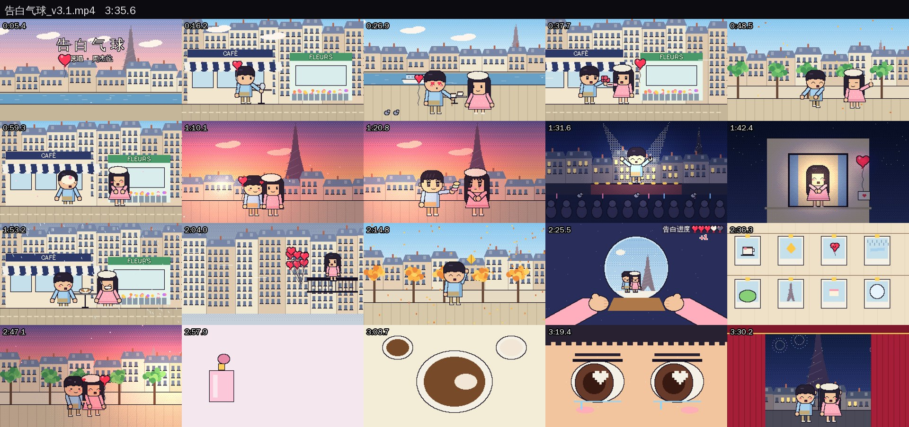

<div align="center">

# LyricFrame · 词帧

**让 AI 写代码，一帧一帧画出你的歌的 MV。**

不用视频生成模型、不用显卡、角色不会变脸。你给一首歌和它的歌词时间文件，AI 按一套从实战里总结出来的导演流程，写出故事、逐句画面、分镜，再用代码画出每一帧、配上原曲。

[English](README.md) · **简体中文**

 

</div>

---

## 它做出来的样子

| 《告白气球》 · 像素风 · 甜歌 | 《蝴蝶》 · 像素风 · 先布光 |
|---|---|
|  |  |
| 38 镜 · 3:36 · [看案例](examples/gaobai-qiqiu) | 42 镜 · 4:39 · [看案例](examples/hudie) |

这两支的完整代码、故事、分镜都在 `examples/` 里。原曲和歌词因为版权原因不在仓库里。

## 三种用法

### ① Claude 应用（不需要任何技术基础）

1. 到 [Releases](https://github.com/leolv131/lyricframe/releases) 下载 `lyricframe-skill.zip`
2. 打开 Claude → 设置 → Capabilities（功能）→ 打开"代码执行"，在 Skills 里点 **Upload skill**，选这个 zip
3. 开一个新对话，上传**歌曲音频**和**歌词文件（.lrc）**，然后说：

   > 帮我把这首歌做成 MV，像素风

AI 会一步步和你确认故事、画面、风格，最后把视频发给你下载。

### ② Claude Code

```bash
git clone https://github.com/leolv131/lyricframe.git
cd lyricframe
claude
```
然后说："用这个项目给 `~/Music/某首歌.mp3` 做 MV，歌词文件在旁边"。Claude Code 会自动读 `CLAUDE.md` → `AGENTS.md`。

### ③ Codex

同样 `git clone` 后在仓库里打开 Codex（它会自动读 `AGENTS.md`）；或者把 `lyricframe-skill.zip` 解压到 `~/.agents/skills/`。
> 规则和审美是按 Claude 调出来的，Codex 上的效果还在测试中。

## 你需要准备

| | 说明 |
|---|---|
| 🎵 歌曲音频 | mp3 / m4a / wav，或者带声音的视频 |
| 📝 歌词时间文件 `.lrc` | 去 **[lrclib.net](https://lrclib.net)** 搜歌名，下载"synced lyrics"。免费、不用注册。没有也行，AI 会用语音识别找时间（慢一些） |
| 🎨 想要的风格（可选） | `8bit 像素` 或 `扁平 Q 版`；不说的话 AI 会按歌的气质推荐 |

默认先做一段 **30–60 秒**（一段主歌 + 一段副歌），满意了再做完整版。一首 4 分钟的歌，完整做下来要几个小时。

## 它是怎么工作的

```
准备素材 → 歌词时间轴 ✋ → 故事 ✋ → 逐句画面表 ✋ → 分镜 ✋ → 风格与情感样片 ✋ → 分章制作 → 合成检查 ✋ → 交付
```

✋ 的地方 AI 会停下来给你看图、问你一个问题。说"不用停，直接出成品"就会一口气做完。

几条最重要的规则（来自和网上口碑好的 AI MV 逐帧对比）：

- **先准，再深**：每一句歌词都要有一个一眼看懂的画面；同一句重复出现时换新画面
- **先有光，再有物**：暗底上的一点暖光，比灰蒙蒙的画面更有情绪
- **少切、一直在动**：按乐句切，每个镜头里都有东西在动
- **一首歌只用一套比喻**，3–4 个核心场景在不同时间、天气里反复出现
- **主角任何时候都必须一眼看清**

完整流程：[docs/zh/workflow.md](docs/zh/workflow.md) · 自检清单：[docs/zh/checklist.md](docs/zh/checklist.md)

## 项目里有什么

```
AGENTS.md / CLAUDE.md   给 AI 读的导演手册
docs/                   完整工作流、自检清单（中 / 英）
templates/              故事、逐句画面表、分镜等模板 + 一个可以直接跑的起步工程 starter/
styles/pixel8bit/       8bit 像素工具包（角色、表情、场景、布光、界面、渲染）+ 字体
styles/flatq/           扁平 Q 版工具包（skia 矢量）+ 字体
tools/lyrics_timing/    .lrc → 时间轴、节拍与段落、语音识别对齐、烧字幕
tools/review/           五项画面指标、抽帧拼图、逐镜对照、字幕遮挡检查
tools/package/          封面（横 / 竖）、上下对比拼接
examples/               《告白气球》《蝴蝶》完整工程
skill/                  打包成 Claude / Codex skill
```

## 关于版权

- **AI 不写、不引用歌词原文。** 歌词文字只在你的 `.lrc` 文件和脚本之间流转（最后烧字幕用），AI 读的只是"第几句、几秒到几秒"。
- **原曲只给你自己的作品配乐**，不要提交到公开仓库。
- 角色都是原创的，不画已有的动漫角色、商标和专辑封面。
- 做好的视频发到平台上时，请遵守平台的音乐使用规则。

## 常见问题

**需要显卡吗？** 不需要。画面是 CPU 上的 numpy / skia 算出来的。像素风大约 1 秒算 1 秒 1080p。有 NVIDIA 显卡时设置 `LF_VCODEC=h264_nvenc` 可以加快编码。

**能做竖屏吗？** 能，第 0 步说"竖屏 / 抖音"就行，输出 1080×1920。

**能换别的画风吗？** 能。工作流和风格无关，风格只决定用哪套"画笔"。水彩、粉笔画、信纸淡彩作者都做过，后续会整理进来；欢迎贡献新画风。

**成本？** 用你自己的 Claude / Codex 套餐。完整 MV 对话很长，额度低的套餐建议先做片段。

## 致谢

这套流程是在这些开源项目的启发下做出来的：
[PDoomVideo](https://github.com/JohnHeibel/PDoomVideo)（逐句画面 + 分章并行的 MV 工程）·
[lemo-opuscar](https://github.com/lemomo-ai/lemo-opuscar)（风格库 + 导演流程）·
[awesome-opus5-5-videos](https://github.com/yihui-dev/awesome-opus5-5-videos)（灵感库）·
[opus-video-prompts](https://github.com/joeseesun/opus-video-prompts)（`seek(t)` 确定性渲染等技巧）

字体：文泉驿正黑、GNU Unifont、思源黑体（Noto Sans CJK），各自的许可证见 `styles/*/fonts/`。

## 作者

**吕行记** — 前华为 AI 工程师，六年 AI 落地经验。用这套流程做的 MV 都发在抖音。

- 抖音：**吕行记**（抖音号 `994770495`）
- GitHub：[@leolv131](https://github.com/leolv131)

欢迎提 issue、PR，或者把你用它做的 MV 发给我看。

## 许可证

代码 [MIT](LICENSE)。字体保持各自的许可证。歌曲、歌词、专辑封面不属于本项目。
