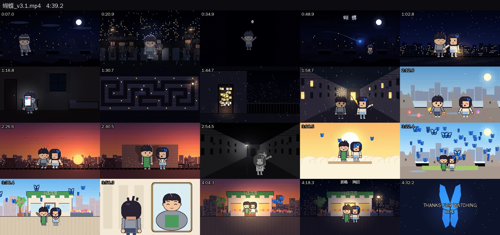
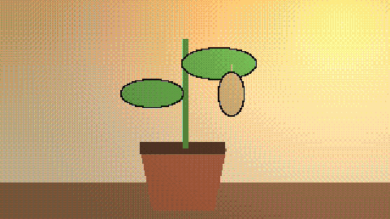

# 案例 · 《蝴蝶》（原唱 · 陶喆）

**像素风 · 先布光 · "光 = 存在感"** — 42 镜 · 4:39 · v3.1





> 原曲和歌词不在仓库里。下面的命令渲染的是**无声画面**；你有自己的音源时加 `--song`。
> The song and lyrics are not in this repo. Rendering is silent unless you pass your own audio with `--song`.

## 一句话立意
他以为自己是一片废墟，她一直把他当成一个还没破的茧。

## 值得看的地方
- **一套比喻贯穿全片**："光 = 存在感"。前半夜里只有冷光，他越来越暗、越来越透明（`Stage.person(alpha<1)` 的抖动半透明 + 虚线轮廓）；她带着暖光来；副歌 2 天亮；终副歌全彩
- **信物**：闪蝶蓝 `#2f8cff` 是全片唯一的高饱和蓝：发夹 → 茧 → 真蝴蝶 → 纸蝴蝶 → 戒指
- **4 个核心场景反复出现**：巷子、废墟、天台、房间，在雨夜 / 天亮 / 黄昏 / 雪夜里各回来几次
- **人物光照后单独合成、保底亮度**（`w3.lit2`，后来提炼成 `styles/pixel8bit/stage.py`）：暗场里主角也看得清
- 唱到"蝴蝶"的三次，画面是同一机位的三个阶段：一只 → 破茧 → 一群

## v1 → v3 → v3.1
| | v1 | v3 第一版样片 | v3.1 |
|---|---|---|---|
| 镜头数 | 72 | — | 42（按乐句切） |
| 叙事 | 灰阶量化 + 她身边一圈恢复颜色 | 远景、小人物、剪影 | 先布光；人物回到 Q 版中景 |
| 问题 | 太亮、太灰、切得太碎 | **人物 14–40 像素高，暗底暗人，完全看不清** | — |

v3 那版失败的样片是 v3.1 最重要的一条规则的来源：**任何时候主角必须一眼看清。**

## 指标（`tools/review/metrics.py --mood moody`）
| 平均镜头 | 暗场帧占比 | 饱和度 | 镜头内动态 | 几乎不动的秒数 |
|---|---|---|---|---|
| 6.5 s | 54 % | 0.44 | 0.74 | 34 % |

光和颜色已经到参考片的水平（暗场 36–53%、饱和度约 0.53）；镜头内动态和静止秒数还有距离（参考值 ≥ 1.0 / ≤ 20 %），下一版可以多加视差层和粒子。

## 文件
- `docs/` — STORY、MUSIC_MAP、LYRIC_SHOTS（v1 逐句画面表）、STYLE_GUIDE、STORYBOARD（v3.1 实际镜头，从代码生成）
- `src/w3.py` — 全片共用：人物合成、4 个核心场景；`c1.py`–`c6.py`、`seg.py` — 各章镜头
- `shots.json` — 镜头表

## 运行
```bash
cd examples/hudie
python src/make.py --still 130                      # 看一帧
python src/make.py --no-song --start 117.5 --end 143.3 --preview   # 副歌 2，720p，无声
python src/make.py --all --song 你的音源.mp3              # 整片 1080p 配原曲
python src/make_cover.py
```
